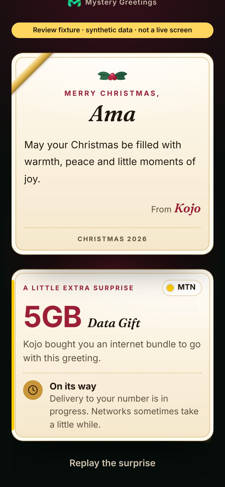
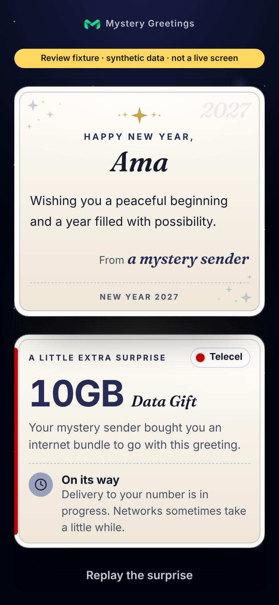
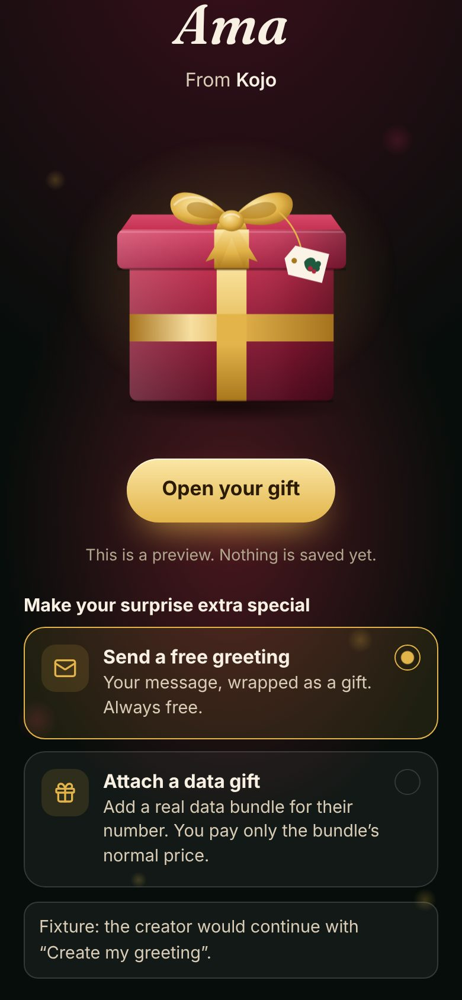
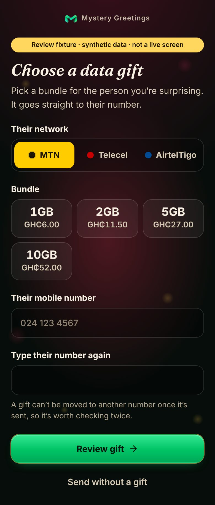

# Mystery Hub 3.7.2 · Mystery Gifts V1

**Status: awaiting backend integration (3.5) and commercial approval.** The complete paid capability does **not** exist. No greeting can carry a data gift, and no customer can buy one. This release merges a dormant, isolated foundation only:

- the public gift contract and its status mapping;
- the sender and recipient designs, as unimported components;
- a local review fixture and tests that keep all of it unreachable from production;
- this document, including the exact Codex handoff (section 6).

The free Mystery Greetings experience is unchanged byte for byte: the production build's entry bundle is identical to main's (`index-BzMsjhbW.js`).

**Starting checkpoint:** `origin/main` at `baf047a` (PR #155, after Release A). The only open PR was the stale draft #69, out of scope. No Codex branch was newer than 27 November.

**What this release does not do:**
- It doesn't switch on Mystery Greetings, Mystery Gifts or any season.
- It doesn't change checkout, payments, prices, the catalogue, suppliers, refunds, orders, financial records or notifications.
- It doesn't touch any server route, database schema, environment variable or secret.

**Screenshots:** [`docs/screenshots/mystery-gifts-3-7-2/`](screenshots/mystery-gifts-3-7-2/). They come from a local review fixture in Chromium with synthetic data. Every screen carries a yellow "Review fixture · synthetic data · not a live screen" banner, and the prices in them are invented. The sandbox cannot reach Cloudinary, so the brand mark is a crop of the approved mark taken from the Greetings preview image.

## 1. What exists today

All of this was checked in code at `baf047a`, not taken from older documents.

| Area | Current reality | Where |
|---|---|---|
| Greetings contract | `GreetingInput` and `PublicGreeting` have no gift, order or payment field. | `shared/mysteryExperiences.ts` |
| Greetings storage | A private optional schema, `mysteryhub_experiences`, with four tables (configuration, greetings, budgets, reports). Nothing links a greeting to an order. | `server/db/mysteryExperiences.sql` |
| Greetings in production | Not live. The schema is not installed, `MYSTERY_GREETING_LINKS_ENABLED` and `MYSTERY_GREETINGS_ENABLED` are off, `EXPERIENCES_TRUSTED_PROXY_CIDRS` is unset and the abuse secret needs separate approval. This comes from the 3.6.1 and 3.7.1 release records; it was not re-read live from this sandbox. | `docs/mystery-greetings-backend-qualification.md` |
| Data checkout | `POST /api/payments/initialize`: price from `CommercialService.catalog()`, MTN duplicate protection, supplier preflight (including beneficiary eligibility), and a guest `requestId` turned into a durable order id. Paystack metadata is `{public_reference, network, service_type:'data', product_id, product_name}`. | `server/routes/api.ts` (Data flow), `server/services/commercialService.ts` `initialize`, `server/services/directCheckoutRecovery.ts` |
| Order identity | `customer_phone` and `recipient_phone` are the same delivery number. The receipt email is the buyer's. A guest's order id is `ord_guest_<sha256(requestId)>`, and a member's order carries `user_id`. | `server/routes/api.ts`, `directCheckoutRecovery.ts` `guestCheckoutId` |
| Payment truth | `GET /api/payments/verify/:reference`, the signed Paystack webhook, `validateOrderPayment` and `FulfilmentService.processPaidOrder`. Pending payments are reconciled every 10 minutes, and supplier status every 3 minutes. | `server/routes/api.ts`, `server.ts` |
| Public order view | `toSafePublicOrder` shows a masked recipient (last four digits only), `status`, `manual_review`, `customer_resolution` and `payment_basis`. `GET /api/orders/lookup/:reference` returns it to anyone holding the reference, and that read can trigger a throttled supplier status check. | `server/types/orders.ts`, `server/routes/api.ts` |
| Service control | Paused networks drop out of the catalogue, so quotes and payment starts refuse them. | `CommercialService.catalog`, `ServiceControlService` |
| Merchant scope | Shared Paystack accepts main-store Data, Instant Bundles and Airtime only. | `shared/paymentAvailability.ts`, `docs/paystack-shared-merchant-isolation.md` |
| Refunds and resolution | `resolution_json` drives `customer_resolution`. The Admin paid-order resolution is the only refund path. | `docs/admin-paid-order-resolution-v1.md` |

**Conclusion.** Paid gifting needs four things that don't exist yet, so this release can't ship a purchase flow without inventing one:
- a durable, server-validated association between a greeting and an order;
- an endpoint to create that association;
- a public gift projection;
- a feature gate.

It also needs free Greetings to be live first, and 3.5 has to qualify the payment scope.

## 2. Product decisions (V1)

- **Direct delivery.** The sender enters the recipient's number and buys an ordinary, fixed-size standard Data bundle. It is delivered through normal Mystery Hub fulfilment. There are no claim codes, vouchers, balances, scheduling, bulk sends or multiple recipients.
- **The greeting stays free.** There is no greeting fee. The sender pays the bundle's authoritative current price, and Mystery Hub earns its normal Data contribution. The founder funds nothing.
- **Data only.** No Instant Bundles or Airtime in V1.
- **The surprise isn't guaranteed.** The network may text the recipient before they open the link. The sender is told this before paying.
- **Free is always the default.** The gift choice appears only when a real purchase can succeed, and free is preselected. "Send without a gift" is on every gift screen.

## 3. Architecture decision

| | A · Ordinary checkout, then attach the paid order | B · Draft linked to a pending checkout (gift intent) |
|---|---|---|
| Development | One new endpoint and one table in the Greetings schema. `POST /api/payments/initialize` is unchanged. | Changes checkout initialization, the most sensitive route, to accept and persist greeting context. |
| Coupling | Checkout never depends on the optional Greetings schema. | Checkout must write to, or wait on, `mysteryhub_experiences`, which can be absent, busy (two-transaction cap) or switched off. |
| Recovery | The order is a complete, ordinary Data order on its own. If attaching fails, the bundle still reaches the number, and attaching can be retried. | Atomic, but a failure in either part fails both, which is worse for a paying customer. |
| Order authorization | The server checks the creator token, plus `user_id` for members or the `requestId` hash for guests. | The same checks, inside checkout. |
| Duplicates and idempotency | The checkout's own `requestId` idempotency, plus a unique order and a unique greeting on the association. | A new combined key across two systems. |
| Abandonment and failed payment | Nothing is attached until payment is confirmed, so the recipient never sees an unpaid gift. | Pending intents need expiry and clean-up. |
| Reconciliation | Unchanged. The order is an ordinary Data sale. | Unchanged, plus intent rows. |
| Cross-device | Members can attach from any device. Guests only on the device that holds the `requestId`. | The same. |

**Chosen: A, attaching after payment is confirmed.** It is the simplest safe model, it keeps the checkout contract untouched, and it never shows a recipient something that wasn't paid for. There is no second Paystack integration and no second dispatch path. To Paystack the payment is exactly what it is: a Mystery Hub Data sale for a recipient number.

### Sender journey (proposed)

1. Design, Message, Preview: the existing creator, unchanged.
2. On Preview, the optional **"Make your surprise extra special"** choice appears, with **Send a free greeting** preselected. It appears only when gifting is available.
3. **Create the greeting.** This is the existing free, idempotent create. The link exists from this point, whatever happens next.
4. If the creator chose a gift, **Choose a data gift**:
   - network (only networks with bundles on offer);
   - bundle;
   - the recipient's number, typed twice.
5. **Review**:
   - the server quote (`GET /api/commercial/quote/:productId`);
   - the price-change note;
   - the surprise caveat;
   - the anonymity note.
6. **Continue to payment** uses the existing Data payment contract (`POST /api/payments/initialize` with `requestId`, `expectedTotalMinor`, `pricingRevision` and `promotionRevision`) and the existing Paystack popup, verification and pending-payment banner.
7. Once verification reports the payment as confirmed, the creator calls the new attach endpoint (section 6).
8. **Share.** This is the existing share screen, now showing "Data gift attached" plus a link to the sender's own receipt through ordinary order tracking.

If the creator abandons at any step from 4 onward, they still have a working free greeting to share.

## 4. Status mapping (implemented as `shared/mysteryGifts.ts`)

The recipient's status is derived from the fields that `toSafePublicOrder` already projects, in the receipt's own order of precedence. It is a projection, not a second state engine.

| Order facts (after `toSafePublicOrder`) | Recipient sees |
|---|---|
| No confirmed payment: `pending_payment`, `cancelled`, `expired`, or an unpaid `failed` (even with `manual_review`) | **Nothing.** No gift is shown. |
| `customer_resolution` = `manual_fulfillment` | **Delivered** (support confirmed the service was completed) |
| `customer_resolution` = `refund_confirmed` or `external_compensation` | **Couldn't be delivered** |
| `manual_review` (no final resolution), or `customer_resolution` = `review` (for example a paid `failed` or a paid `refunded` status) | **Being checked** |
| `customer_resolution` = `refund_pending`, or `refund_pending` / `refunded` with no resolution | **Couldn't be delivered** |
| `delivered` | **Delivered** |
| `paid`, `queued`, `submitted`, `processing` | **On its way** |
| An attached order that cannot be read right now | **Status unavailable** (with Check again) |

**Guarantees, each pinned by a test that runs every combination:**
- No gift is ever shown without the receipt also calling the payment confirmed.
- "Delivered" appears only where the receipt also says delivered.
- "On its way" appears only where the Orders list says in progress.
- Complimentary or operator-recorded orders, and non-Data services, never become gifts.

**Public gift (the only fields a greeting response may ever carry):** `{ schemaVersion: 1, kind: 'data', network, allowance, status }`.

- It never includes an amount, reference, phone number or any of its digits, an email, a name, a date, a supplier, or anything about payments or refunds.
- The allowance must match the catalogue's own format, such as `5GB`, so a legacy snapshot containing contact text can never pass.
- `readPublicGift` in the browser refuses any response that carries an extra field.

## 5. Design

**Recipient: the second reveal** (`src/greetings/gifts/GiftReveal.tsx`)
- The letter stays exactly as it is. Once it has been read, a small gift tag hangs below it on a short champagne string: **A LITTLE EXTRA SURPRISE**, "There's something else with this greeting." and **Reveal your extra gift**.
- The tag opens into a paper card in the occasion's own palette:
  - the network pill;
  - the allowance large (for example **5GB *Data Gift***);
  - "Kojo bought you an internet bundle to go with this greeting.", or "Your mystery sender…" when the sender is hidden, matching the letter's "a mystery sender";
  - a tear line, then the status.
- The network's colour runs down the card's edge (the Data store's own MTN, Telecel and AirtelTigo colours).
- **Motion:** one finite rise. Reduced motion shows the card at once. Focus moves to the gift's heading so screen readers announce it, and the status is a live region.
- **Wording never asks the recipient to act.** "Couldn't be delivered" says "Mystery Hub will look after it with your sender. There's nothing you need to do." No money, numbers or references appear.

**Sender** (`src/greetings/gifts/GiftSender.tsx`)
- **`GiftChoice`** renders nothing unless the caller says gifting is available. When it renders, it shows two cards:
  - "Send a free greeting": Always free (preselected);
  - "Attach a data gift": you pay only the bundle's normal price.
- **`GiftPicker`**:
  - **Bundles:** only networks with bundles on offer. Bundles and prices come straight from the server catalogue's shape (`giftProductsFromCatalogue`), never from this code.
  - **Number:** grouped as it is typed (`024 555 0187`) and typed twice, with "A gift can't be moved to another number once it's sent".
  - **Focus:** clear errors, with focus moved to the first problem.
  - **Review:** waits for the server's price before **Continue to payment** is enabled. It notes a price change, the possible early network text, that the link never shows the price or the number, and, for a hidden sender, that receipt details stay with Mystery Hub and the payment provider as for any order.
  - **No dead ends:** loading, a failed catalogue and no bundles available all keep **Send without a gift** one tap away.

| | |
|---|---|
|  |  |
|  |  |
|  |  |
|  |  |

Also in the folder:
- the review, couldn't-be-delivered and status-unavailable cards;
- the card at 320 px and on desktop;
- input errors, a price change and a failed catalogue.

## 6. Codex handoff (3.5): what must exist before any gift is sold

Everything below is **proposed**. None of these endpoints, tables or settings exist today.

**6.1 Prerequisites, all separately authorized**
1. **Free Greetings live:** trusted ingress, schema installed, abuse secret, links and creation gates (the existing runbook).
2. **Merchant scope.** 3.5 confirms with Paystack, and records, that a standard Data purchase started from the Greetings surface for a recipient number is within the approved telecommunications scope. The founder approves that record.
3. **Service status.** Standard Data is purchasable in the Service Control Center for at least one network. Use actual status; do not lift the MTN maintenance pause for this.

**6.2 Association (proposed table, in the private Greetings schema)**

`mysteryhub_experiences.greeting_gifts`:
- `greeting_id uuid PRIMARY KEY REFERENCES greetings(id) ON DELETE CASCADE` (one gift per greeting in V1);
- `order_id text UNIQUE NOT NULL` (one greeting per order);
- `network text NOT NULL`;
- `allowance text NOT NULL` (snapshots kept for **Status unavailable**);
- `attached_at timestamptz NOT NULL`;
- `attach_key uuid NOT NULL`.

RLS, permissions and ownership should follow the existing four tables. Avoid a foreign key into `public.orders`, so the Greetings schema stays optional. Teach the B1 order-deletion evidence check to treat an association as connected evidence.

**6.3 Attach endpoint (proposed)**

`POST /api/experiences/greetings/:shareId/gift`
- **Headers:** `Authorization: Greeting <creatorToken>`, plus the member session if signed in.
- **Body:** `{ orderReference, requestId?, attachKey }`.

The server must check, in one transaction:
- The gifts gate is on, creation is available, and the visitor path is established.
- The greeting exists, is live, and the creator token hash matches.
- **Order:**
  - it is found by its reference;
  - `isDirectDataCheckout(order)` holds;
  - `payment_status === 'success'`, and the status is beyond `pending_payment`;
  - it was created after the greeting and within 24 hours of it.
- **Ownership:**
  - a member order needs `order.user_id === req.user.id`;
  - a guest order (`user_id` null) needs `order.id === guestCheckoutId(requestId)`.
  - A client-supplied reference alone is **never** proof.
- **Uniqueness:**
  - the greeting has no gift and the order has no greeting;
  - replaying the same key with the same pair returns the same result;
  - anything else is a `409`.

Errors should use the existing uniform 404 for an unknown greeting or a wrong token, and never say whether an order exists. Rate limiting should share the creator-management budget. Attaching never touches the order, the payment or the supplier.

**6.4 Public read**

`GET /api/experiences/greetings/:shareId` adds `gift` only when an association exists, built with `publicGift(toSafePublicOrder(order))`. It falls back to `unavailableGift(network, allowance)` if the order read fails, and omits `gift` when the mapping returns null.
- It reads stored order state only. It must **never** call `refreshOrderStatusIfDue`, verification or the supplier: the 3-minute reconciler and webhooks keep the state fresh.
- It must not add database work to the global read budget beyond one indexed lookup.
- The `/g/:shareId` HTML head stays generic and never mentions a gift.

**6.5 Availability and gate**
- `MYSTERY_GIFTS_ENABLED`: exact `true` only, default off. It is effective only when `greetingCreationAvailable()` and `sharedMerchantCheckoutAvailable('data')` both hold and at least one Data product is active in `CommercialService.catalog()`.
- `GET /api/experiences/templates` adds `giftsConfigured` computed from all of those, and the creator offers `GiftChoice` only when it is true.
- Turning the gate off stops new attachments and the offer. Existing attached gifts stay visible, because they are real purchases. To hide everything, use the existing links gate.

**6.6 Payment, recovery and reconciliation**
- **Checkout:** the existing contract, unchanged, including the MTN duplicate rule, preflight, price revisions, Paystack popup, verification, webhook, pending-payment banner and receipt.
- **Pending gift attempt:** the creator keeps `{shareId, orderReference, requestId (guest only), productId, startedAt}` in the same device storage as the creator token. It is never in a link, analytics or a log. On return, or after a lost response, the creator retries the attach, which is idempotent. Members can also attach from their account orders.
- **Never automatic:**
  - no refund because a greeting was removed or expired;
  - no resubmission of an uncertain order;
  - no second charge.
  A paid order that never gets attached is still an ordinary, delivered Data order.
- **Welcome offer:** it stays tied to the signed-in buyer's own phone, exactly as today. Any discount appears only in the sender's quote and receipt.
- **MTN:** if the recipient already has an MTN bundle in progress, checkout refuses (`ACTIVE_MTN_ORDER`). The gift UI must say "This number already has an MTN bundle on its way. Try again later or choose another network" without revealing anything about that other order.

**6.7 Retention and deletion**
- When the creator revokes the greeting, or it expires, the link returns 404 and the association stays until the existing maintenance removes the greeting 30 days later. The association cascades with it.
- The order, payment, receipt, tracking and finance records are untouched throughout.
- Admin greeting moderation stays independent of order resolution. No new refund dashboard is needed; support uses the existing order tools with the sender's reference.

**6.8 Isolated tests required (disposable PostgreSQL 17, synthetic data only)**
- **Attach:** guest and member attach, a wrong token, a wrong `requestId`, another member's order, an unpaid order, a cancelled order, an order older than the greeting, and an order outside 24 hours.
- **Uniqueness:** a double attach (same key or different key), the same order to two greetings and a second order to one greeting.
- **Lifecycle:** a revoked greeting, an expired greeting, maintenance cascade, and a missing or busy schema (checkout must keep working).
- **Recovery:** gate off, gate on with creation off, a lost response retried, and payment success with the browser closed, then attach later.
- **Status:** every status row in section 4 through real stored orders, and a supplier update or webhook changing the recipient's view.
- **Privacy:** byte-level checks that the public JSON has exactly five gift fields, for every order state.
- **Load:** the read path's statement count against the existing capacity model.

**6.9 Production qualification (separate approval)**

After 6.1 and the tests, run one founder-approved controlled purchase on the real domain, with a real small bundle to a founder-owned number. Check:
- attach;
- the recipient view on two devices;
- delivery status changes;
- the receipt;
- reconciliation;
- support visibility.

Then decide on activation. Synthetic tests and this release's fixtures are not financial qualification.

## 7. Integration plan (Claude, after 6.3 and 6.4 exist)

1. **Creator:** `GiftChoice` on Preview when `giftsConfigured` is true, and `GiftPicker` after the create.
2. **Checkout:** use the existing Data payment contract and `usePaystack` from the Greetings bundle, reusing `CheckoutModal`'s request-identity and recovery rules rather than its markup. Keep the greeting chunk small (a Release C concern).
3. **Attach and recover:** attach after verification, with recovery on return, and the share screen showing the gift and the sender's receipt link.
4. **Recipient:** `GiftReveal` under the letter when `readPublicGift(greeting.gift)` returns a gift. Analytics stay as they are, with no gift or payment events.
5. **Tests:** browser tests against a disposable database with the real endpoints, guest and member, and account switching.

## 8. Verification (this release)

| Check | Result |
|---|---|
| Type check (`tsc --noEmit`) | Clean |
| Production build | Passes. The output contains no gift code (`grep mgg-`: 0 files), and the entry bundle `index-BzMsjhbW.js` is identical to main's. |
| Focused suite `mysteryGifts372.test.ts` | **17 / 17 pass**: every order-state combination against the receipt and the Orders list, privacy over every combination, a strict reader, recipient and sender rendering, catalogue filtering, number checks, isolation, no server calls or prices, scoped and finite CSS |
| Full regression | **3,784 tests, 3,722 pass, 0 fail, 62 skipped** (baseline on `baf047a`: 3,767 / 3,705 / 0 / 62; +17 new). The 62 skipped are the opt-in native PostgreSQL suites. No server or database code changed. |
| Browser review (`scripts/reviewMysteryGifts.cjs`, Chromium) | **16 / 16 checks pass** (detailed below) |
| Free Greetings | No live Greetings file changed (a test pins that `main.tsx`, `CreatorPage`, `RecipientPage`, `GreetingStage` and `api.ts` don't reference gift code), and the production bundle is identical. The database-backed Greetings browser review was not re-run, because there was nothing to re-test. |

**What the browser review covered:**
- all five recipient states;
- keyboard opening with focus landing on the gift;
- New Year Starlight with Telecel and reduced motion;
- 320 px and 1280 px;
- the free-first choice with arrow keys;
- the full picker flow (errors, focus, number mismatch, waiting for the server price, keeping the selection);
- review with a price change and the anonymity note;
- no gifts and a failed catalogue;
- a short keyboard-open screen;
- no unexpected network requests;
- axe: no serious or critical issues on any screen.

**Not covered.** This is browser emulation, not testing on a physical device. No real purchase, payment, supplier call or refund was made or simulated against a server. No financial qualification is claimed.

## 9. Activation and rollback

- **Activation:** only after section 6 is complete and separately authorized, then a new Claude integration release (section 7) behind the gate. Nothing in this release can be activated.
- **Rollback of this release:** revert the commit. Nothing in production uses it.
- **Future rollback:** gate off (no new gifts), then the links gate if the links themselves must stop. Never drop the schema or touch orders as a rollback.

## 10. Remaining dependencies and founder actions

1. **Free Greetings launch:** the founder's existing steps (ingress evidence, schema, secret, gates).
2. **3.5:**
   - merchant-scope confirmation for Data bought from Greetings;
   - the attach endpoint, table, public read and gate (sections 6.2 to 6.8).
3. **Founder approval** of the merchant record, then of one controlled real purchase (6.9), then of activation.
4. **Claude integration release** once 3.5 lands (section 7).

## 11. Notes for Release C (performance)

- The gift components are not in any production chunk, so they add 0 bytes.
- When integrated, keep the gift step lazy-loaded inside the Greetings bundle, and don't pull the main app's `CheckoutModal` into `/greetings`. The existing App preload on `/g` and `/greetings` (noted in 3.7.1) is the bigger cost to remove.
