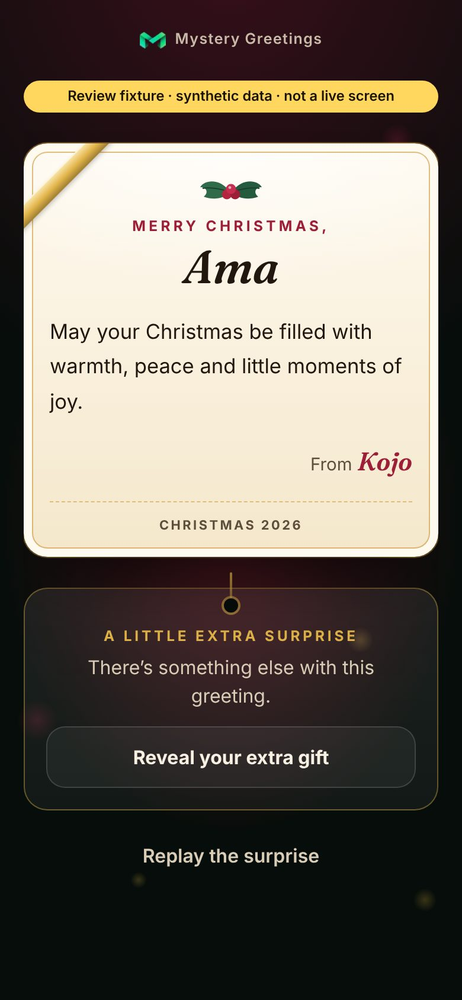
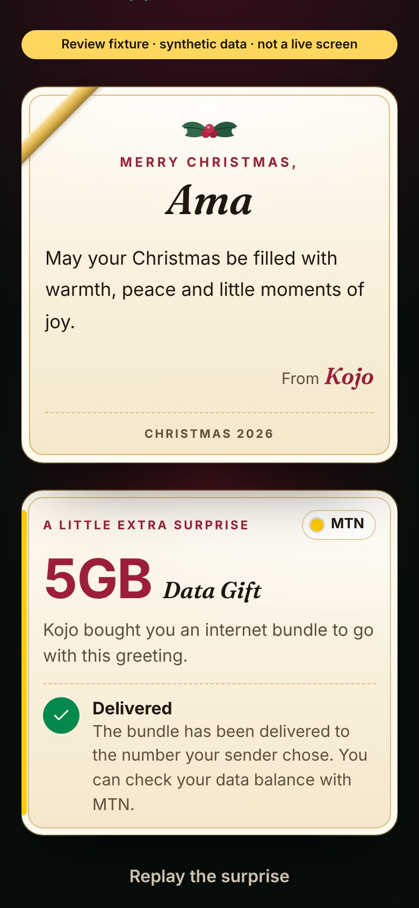
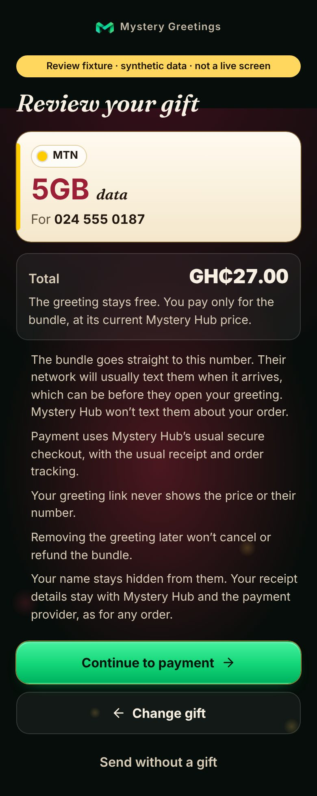
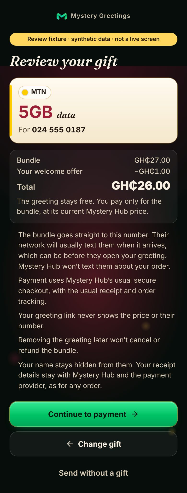
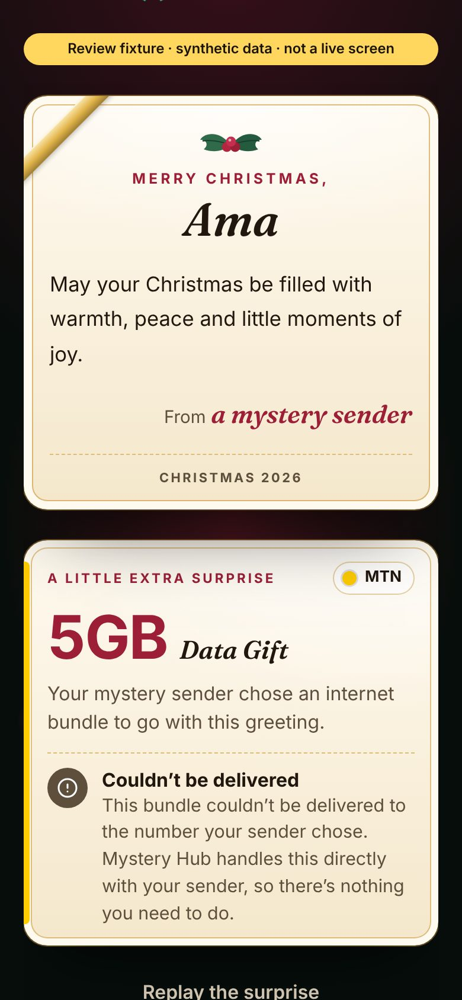

# Mystery Hub 3.7.2 · Mystery Gifts V1

**Status: awaiting backend integration (3.5) and commercial approval.** The complete paid capability does **not** exist. No greeting can carry a data gift, and no customer can buy one. This release merges a dormant, isolated foundation only:

- the public gift contract and its status mapping;
- the sender and recipient designs, as unimported components;
- a local review fixture and tests that keep all of it unreachable from production;
- this document, including the exact Codex handoff (section 6).

The free Mystery Greetings experience is unchanged byte for byte: the production build's entry bundle is identical to main's (`index-BzMsjhbW.js`).

**Starting checkpoint:** `origin/main` at `baf047a` (PR #155, after Release A). The only open PR was the stale draft #69, out of scope. No Codex branch was newer than 27 November.

**What this release does not do:**
- It doesn't switch on Mystery Greetings, Mystery Gifts or any season.
- It doesn't change checkout, payments, prices, the catalogue, suppliers, refunds, orders, financial records or notifications.
- It doesn't touch any server route, database schema, environment variable or secret.

**Screenshots:** [`docs/screenshots/mystery-gifts-3-7-2/`](screenshots/mystery-gifts-3-7-2/). They come from a local review fixture in Chromium with synthetic data. Every screen carries a yellow "Review fixture · synthetic data · not a live screen" banner, and the prices in them are invented. The sandbox cannot reach Cloudinary, so the brand mark is a crop of the approved mark taken from the Greetings preview image.

## 1. What exists today

All of this was checked in code at `baf047a`, not taken from older documents.

| Area | Current reality | Where |
|---|---|---|
| Greetings contract | `GreetingInput` and `PublicGreeting` have no gift, order or payment field. | `shared/mysteryExperiences.ts` |
| Greetings storage | A private optional schema, `mysteryhub_experiences`, with four tables (configuration, greetings, budgets, reports). Nothing links a greeting to an order. | `server/db/mysteryExperiences.sql` |
| Greetings in production | Not live. The schema is not installed, `MYSTERY_GREETING_LINKS_ENABLED` and `MYSTERY_GREETINGS_ENABLED` are off, `EXPERIENCES_TRUSTED_PROXY_CIDRS` is unset and the abuse secret needs separate approval. This comes from the 3.6.1 and 3.7.1 release records; it was not re-read live from this sandbox. | `docs/mystery-greetings-backend-qualification.md` |
| Data checkout | `POST /api/payments/initialize`: price from `CommercialService.catalog()`, MTN duplicate protection, supplier preflight (including beneficiary eligibility), and a guest `requestId` turned into a durable order id. Paystack metadata is `{public_reference, network, service_type:'data', product_id, product_name}`. | `server/routes/api.ts` (Data flow), `server/services/commercialService.ts` `initialize`, `server/services/directCheckoutRecovery.ts` |
| Order identity | `customer_phone` and `recipient_phone` are the same delivery number. The receipt email is the buyer's. A guest's order id is `ord_guest_<sha256(requestId)>`, and a member's order carries `user_id`. | `server/routes/api.ts`, `directCheckoutRecovery.ts` `guestCheckoutId` |
| Payment truth | `GET /api/payments/verify/:reference`, the signed Paystack webhook, `validateOrderPayment` and `FulfilmentService.processPaidOrder`. Pending payments are reconciled every 10 minutes, and supplier status every 3 minutes. | `server/routes/api.ts`, `server.ts` |
| Public order view | `toSafePublicOrder` shows a masked recipient (last four digits only), `status`, `manual_review`, `customer_resolution` and `payment_basis`. `GET /api/orders/lookup/:reference` returns it to anyone holding the reference, and that read can trigger a throttled supplier status check. | `server/types/orders.ts`, `server/routes/api.ts` |
| Service control | Paused networks drop out of the catalogue, so quotes and payment starts refuse them. | `CommercialService.catalog`, `ServiceControlService` |
| Merchant scope | Shared Paystack accepts main-store Data, Instant Bundles and Airtime only. | `shared/paymentAvailability.ts`, `docs/paystack-shared-merchant-isolation.md` |
| Refunds and resolution | `resolution_json` drives `customer_resolution`. The Admin paid-order resolution is the only refund path. | `docs/admin-paid-order-resolution-v1.md` |
| Automatic order SMS | The default automatic events (`order_processing`, `order_delivered`, `delivery_attention`) go to the buyer's own phone for a member order, but to `recipient_phone` for a guest order. The guest copy reads "A 5GB MTN data order for 024XXXX187 has been received and is processing…", and `order_processing` fires on `submitted`, seconds after payment. | `server/sms/policy.ts` `orderRecipients`, `shared/smsTransactional.ts` |
| Support and contacts | Admin shows `customer_phone` as "Customer phone" with a WhatsApp link. Contact Hub lists a guest order's `recipient_phone` as a guest contact. | `src/components/admin/sections/AdminOrdersSection.tsx`, `server/db/contactHubStore.ts` |
| MTN duplicate rule | While an MTN order for a number is in a blocking status (including `refund_pending`, which can last days), no other MTN order for that number can start. | `server/services/duplicateOrderProtection.ts` `MTN_BLOCKING_STATUSES` |

**Conclusion.** Paid gifting needs five things that don't exist yet, so this release can't ship a purchase flow without inventing one:
- a durable, server-validated association between a greeting and an order;
- endpoints to reserve and attach that association;
- a public gift projection;
- a way to keep Mystery Hub's own messages and support contact away from a gift's recipient (today a guest sender's order texts the recipient within seconds of payment);
- a feature gate.

It also needs free Greetings to be live first, and 3.5 has to qualify the payment scope.

## 2. Product decisions (V1)

- **Direct delivery.** The sender enters the recipient's number and buys an ordinary, fixed-size standard Data bundle. It is delivered through normal Mystery Hub fulfilment. There are no claim codes, vouchers, balances, scheduling, bulk sends or multiple recipients.
- **The greeting stays free.** There is no greeting fee. The sender pays the bundle's authoritative current price, and Mystery Hub earns its normal Data contribution. The founder funds nothing.
- **Data only.** No Instant Bundles or Airtime in V1.
- **The surprise isn't guaranteed, but Mystery Hub never spoils it.** The recipient's network will usually text them when the bundle lands, possibly before they open the link, and the sender is told this before paying. Mystery Hub itself must never text, call or WhatsApp the recipient about the sender's order (section 6.6); that is a launch requirement, not a nice-to-have.
- **The buyer is the customer.** The recipient is not a Mystery Hub customer because of a gift: support contacts the buyer by receipt email, and the recipient's number is never used for marketing.
- **Free is always the default.** The gift choice appears only when a real purchase can succeed, and free is preselected. "Send without a gift" is on every gift screen.

## 3. Architecture decision

| | A · Ordinary checkout, then attach the paid order | B · Draft linked to a pending checkout (gift intent) |
|---|---|---|
| Development | One new endpoint and one table in the Greetings schema. `POST /api/payments/initialize` is unchanged. | Changes checkout initialization, the most sensitive route, to accept and persist greeting context. |
| Coupling | Checkout never depends on the optional Greetings schema. | Checkout must write to, or wait on, `mysteryhub_experiences`, which can be absent, busy (two-transaction cap) or switched off. |
| Recovery | The order is a complete, ordinary Data order on its own. If attaching fails, the bundle still reaches the number, and attaching can be retried. | Atomic, but a failure in either part fails both, which is worse for a paying customer. |
| Order authorization | The server checks the creator token, plus `user_id` for members or the `requestId` hash for guests. | The same checks, inside checkout. |
| Duplicates and idempotency | The checkout's own `requestId` idempotency, plus a unique order and a unique greeting on the association. | A new combined key across two systems. |
| Abandonment and failed payment | Nothing is shown until payment is confirmed, so the recipient never sees an unpaid gift. | Pending intents need expiry and clean-up. |
| Recipient notices | Needs a reservation before payment (below), or Mystery Hub's own guest SMS reaches the recipient before the attach. | Known at checkout, so it can be suppressed, at the cost of changing checkout. |
| Reconciliation | Unchanged. The order is an ordinary Data sale. | Unchanged, plus intent rows. |
| Cross-device | Members can attach from any device. Guests only on the device that holds the `requestId`. | The same. |

**Chosen: A, with a reservation recorded before payment, and the gift shown only after payment is confirmed.** It keeps the checkout contract untouched and never shows a recipient something that wasn't paid for. There is no second Paystack integration and no second dispatch path. To Paystack the payment is exactly what it is: a Mystery Hub Data sale for a recipient number.

**Why the reservation.** The independent review found that plain A (attach only after payment) is too late. A guest order texts its recipient on `submitted`, seconds after payment and before any attach, so Mystery Hub itself would spoil the surprise and later tell the recipient about the sender's order problems. The fix keeps checkout unchanged:
- a guest order's id is deterministic (`guestCheckoutId(requestId)`), and a member order is found by its `direct:<requestId>` finance operation;
- so the creator reserves the gift against that checkout identity **before** calling `POST /api/payments/initialize` with the same `requestId`;
- the notification, Admin and Contact Hub paths can then recognize a gift order from its first moment, and the attach after payment must match the reservation, which also binds the order to one specific greeting (the creator secret is browser-wide).

### Sender journey (proposed)

1. Design, Message, Preview: the existing creator, unchanged.
2. On Preview, the optional **"Make your surprise extra special"** choice appears, with **Send a free greeting** preselected. It appears only when gifting is available.
3. **Create the greeting.** This is the existing free, idempotent create. The link exists from this point, whatever happens next.
4. If the creator chose a gift, **Choose a data gift**:
   - network (only networks with bundles on offer);
   - bundle;
   - the recipient's number, typed twice.
5. **Review**:
   - the server quote (`GET /api/commercial/quote/:productId`), accepted only for the bundle under review;
   - a welcome offer shown as itself, and a price-change note only for a real change in the bundle's price;
   - the surprise caveat, that removing the greeting won't cancel the bundle, and the anonymity note.
6. **Continue to payment**:
   - first the new reservation (proposed, section 6.3) with a fresh `requestId`; if it fails, no payment starts and the free greeting stays ready;
   - then the existing Data payment contract (`POST /api/payments/initialize` with that `requestId`, `expectedTotalMinor`, `expectedRegularMinor`, `expectedStandardMinor`, `pricingRevision` and `promotionRevision`) and the existing Paystack popup, verification and pending-payment banner.
7. Once verification reports the payment as confirmed, the creator calls the new attach endpoint (section 6.3).
8. **Share.** This is the existing share screen, now showing "Data gift attached" plus a link to the sender's own receipt through ordinary order tracking.

If the creator abandons at any step from 4 onward, they still have a working free greeting to share.

## 4. Status mapping (implemented as `shared/mysteryGifts.ts`)

The recipient's status is derived from the fields that `toSafePublicOrder` already projects, in the receipt's own order of precedence. It is a projection, not a second state engine.

| Order facts (after `toSafePublicOrder`) | Recipient sees |
|---|---|
| No confirmed payment: `pending_payment`, `cancelled`, `expired`, or an unpaid `failed` (even with `manual_review`) | **Nothing.** No gift is shown. |
| `customer_resolution` = `manual_fulfillment` | **Delivered** (support confirmed the service was completed) |
| `customer_resolution` = `refund_confirmed` or `external_compensation` | **Couldn't be delivered** |
| `manual_review` (no final resolution), or `customer_resolution` = `review` (for example a paid `failed` or a paid `refunded` status) | **Being checked** |
| `customer_resolution` = `refund_pending`, or `refund_pending` / `refunded` with no resolution | **Couldn't be delivered** |
| `delivered` | **Delivered** |
| `paid`, `queued`, `submitted`, `processing` | **On its way** |
| An attached order that cannot be read right now | **Status unavailable** (with Check again) |

**Guarantees, each pinned by a test that runs every combination:**
- No gift is ever shown without the receipt also calling the payment confirmed.
- "Delivered" appears only where the receipt also says delivered.
- "On its way" appears only where the Orders list says in progress.
- Complimentary or operator-recorded orders, and non-Data services, never become gifts.

**Public gift (the only fields a greeting response may ever carry):** `{ schemaVersion: 1, kind: 'data', network, allowance, status }`.

- It never includes an amount, reference, phone number or any of its digits, an email, a name, a date, a supplier, or anything about payments or refunds.
- The allowance must match the catalogue's own format, such as `5GB`, so a legacy snapshot containing contact text can never pass.
- `readPublicGift` in the browser refuses any response that carries an extra field.

## 5. Design

**Recipient: the second reveal** (`src/greetings/gifts/GiftReveal.tsx`)
- The letter stays exactly as it is. Once it has been read, a small gift tag hangs below it on a short champagne string: **A LITTLE EXTRA SURPRISE**, "There's something else with this greeting." and **Reveal your extra gift**.
- The tag opens into a paper card in the occasion's own palette:
  - the network pill;
  - the allowance large (for example **5GB *Data Gift***);
  - "Kojo bought you an internet bundle to go with this greeting.", or "Your mystery sender…" when the sender is hidden, matching the letter's "a mystery sender";
  - a tear line, then the status.
- The network's colour runs down the card's edge (the Data store's own MTN, Telecel and AirtelTigo colours).
- **Motion:** one finite rise. Reduced motion shows the card at once. Focus moves to the gift's heading so screen readers announce it, and the status is a live region.
- **Wording never asks the recipient to act, and never claims what a greeting can't know.** A greeting has no phone number and links get forwarded, so the card says "delivered to the number your sender chose", never "your number". "Couldn't be delivered" says "Mystery Hub handles this directly with your sender, so there's nothing you need to do." No money, numbers or references appear. A test pins every status's copy word for word.
- **Focus:** after **Check again**, focus moves to the new status rather than dropping to the page. The gift's heading level can follow the page outline, as `GreetingStage`'s does.

**Sender** (`src/greetings/gifts/GiftSender.tsx`)
- **`GiftChoice`** renders nothing unless the caller says gifting is available. When it renders, it shows two cards:
  - "Send a free greeting": Always free (preselected);
  - "Attach a data gift": the greeting stays free; you pay only for the bundle.
- **`GiftPicker`**:
  - **Bundles:** only networks with bundles on offer. Bundles and prices come straight from the server catalogue's shape (`giftProductsFromCatalogue`), never from this code.
  - **Number:** grouped as it is typed (`024 555 0187`) and typed twice, with "A gift can't be moved to another number once it's sent".
  - **Focus:** clear errors, with focus moved to the first problem.
  - **Review:** waits for the server's price **for this bundle** before **Continue to payment** is enabled; a leftover quote for another bundle counts as still checking. A signed-in buyer's welcome offer is shown as its own line, and the price-change note appears only when the bundle's own price moved. The notes say the network will usually text them, that Mystery Hub won't, that the link never shows the price or the number, that removing the greeting won't cancel or refund the bundle, and, for a hidden sender, that receipt details stay with Mystery Hub and the payment provider as for any order.
  - **What reaches checkout** is built by two small functions, `giftSelection` and `giftCheckout`: only a bundle of the network on show, only a complete number as its 10 digits, and only the amounts and revisions of a ready quote for that same bundle (`giftQuoteFromServer` reads the real `GET /api/commercial/quote/:productId` shape and refuses anything that doesn't add up).
  - **No dead ends:** loading, a failed catalogue and no bundles available all keep **Send without a gift** one tap away.

| | |
|---|---|
|  |  |
|  |  |
|  |  |
|  |  |
|  |  |

Also in the folder:
- the being-checked and status-unavailable cards;
- the card at 320 px and on desktop;
- input errors, a price change and a failed catalogue.

## 6. Codex handoff (3.5): what must exist before any gift is sold

Everything below is **proposed**. None of these endpoints, tables or settings exist today.

**6.1 Prerequisites, all separately authorized**
1. **Free Greetings live:** trusted ingress, schema installed, abuse secret, links and creation gates (the existing runbook).
2. **Merchant scope.** 3.5 confirms with Paystack, and records, that a standard Data purchase started from the Greetings surface for a recipient number is within the approved telecommunications scope. The founder approves that record.
3. **Service status.** Standard Data is purchasable in the Service Control Center for at least one network. Use actual status; do not lift the MTN maintenance pause for this.

**6.2 Association (proposed table, in the private Greetings schema)**

`mysteryhub_experiences.greeting_gifts`, one row per greeting, written at reservation and completed at attach:
- `greeting_id uuid PRIMARY KEY REFERENCES greetings(id) ON DELETE CASCADE` (one gift per greeting in V1);
- `checkout_key text UNIQUE NOT NULL`: for a guest, the future order id `guestCheckoutId(requestId)`; for a member, a hash of the user id and `requestId` (their order is found through the `direct:<requestId>` finance operation);
- `user_id uuid NULL` (the member who reserved; null for a guest);
- `product_id text NOT NULL`, `network text NOT NULL`, `allowance text NOT NULL` (snapshots kept for **Status unavailable**);
- `reserved_at timestamptz NOT NULL`;
- `order_id text UNIQUE NULL` and `attached_at timestamptz NULL`, set together by the attach (one greeting per order).

RLS, permissions and ownership should follow the existing four tables. Avoid a foreign key into `public.orders`, so the Greetings schema stays optional. Teach the B1 order-deletion evidence check to treat an attached row as connected evidence. Unattached reservations older than 24 hours are removed by the existing maintenance.

**6.3 Reserve and attach endpoints (proposed)**

Both take `Authorization: Greeting <creatorToken>`, plus the member session if signed in. Both use the existing uniform 404 for an unknown greeting, a wrong token or a malformed `requestId` (`guestCheckoutId` throws its own error for one, which must be mapped to that 404), and never say whether an order exists. Rate limiting shares the creator-management budget. Neither touches the order, the payment or the supplier.

`POST /api/experiences/greetings/:shareId/gift/reservation`, before payment. **Body:** `{ requestId, productId }`.
- The gifts gate is on, creation is available, and the visitor path is established.
- The greeting exists, is live, its creator token hash matches, and it has no gift.
- `productId` is an active standard Data product in `CommercialService.catalog()` on a purchasable network.
- No order exists yet for this checkout identity, and the key isn't reserved by another greeting.
- Replaying the same greeting, `requestId` and product returns the same result; anything else is a `409`.
- The client calls `initialize` only after this succeeds, with the same `requestId`.

`POST /api/experiences/greetings/:shareId/gift`, after verification confirms payment. **Body:** `{ requestId, orderReference }`. In one transaction:
- The reservation for this greeting exists and its `checkout_key` matches this `requestId` (and this member).
- **Order:**
  - it is found by its reference, and is the order of that checkout identity: for a guest `order.id === guestCheckoutId(requestId)` with `user_id` null; for a member `order.user_id === req.user.id` and the `direct:<requestId>` operation names it;
  - `isDirectDataCheckout(order)` holds, so V1 gifts are Paystack direct Data checkouts only; wallet payment is out of scope;
  - `payment_status === 'success'` with a valid `paid_at`, and the status is beyond `pending_payment`;
  - `order.product_id` is the reserved product;
  - it was created after the reservation and within 24 hours of it.
  - A client-supplied reference alone is **never** proof.
- **Uniqueness:** the order has no other greeting. Replaying the same pair returns the same result; anything else is a `409`.

**6.4 Public read**

`GET /api/experiences/greetings/:shareId` adds `gift` only when an attached association exists. It first re-checks the raw order, not only its projection: `isDirectDataCheckout(order)`, `payment_status === 'success'` and a valid `paid_at` (the projection alone treats any resolution as proof of payment, and legacy rows without `service_type` come out as Data). Only then is it built with `publicGift(toSafePublicOrder(order))`. It falls back to `unavailableGift(network, allowance)` if the order read fails, and omits `gift` when the mapping returns null or a check fails.
- It reads stored order state only. It must **never** call `refreshOrderStatusIfDue`, verification or the supplier: the 3-minute reconciler and webhooks keep the state fresh.
- It must not add database work to the global read budget beyond one indexed lookup.
- The `/g/:shareId` HTML head stays generic and never mentions a gift.

**6.5 Availability and gate**
- `MYSTERY_GIFTS_ENABLED`: exact `true` only, default off. It is effective only when `greetingCreationAvailable()` and `sharedMerchantCheckoutAvailable('data')` both hold and at least one Data product is active in `CommercialService.catalog()`.
- `GET /api/experiences/templates` adds `giftsConfigured` computed from all of those, and the creator offers `GiftChoice` only when it is true.
- Turning the gate off stops new attachments and the offer. Existing attached gifts stay visible, because they are real purchases. To hide everything, use the existing links gate.

**6.6 Payment, recovery and reconciliation**
- **Checkout:** the existing contract, unchanged, including the MTN duplicate rule, preflight, price revisions, Paystack popup, verification, webhook, pending-payment banner and receipt.
- **Pending gift attempt:** the creator keeps `{shareId, requestId, orderReference, productId, startedAt}` in the same device storage as the creator token, because the existing checkout clears its own `requestId` on success. It is never in a link, analytics or a log. On return, or after a lost response, the creator retries the attach, which is idempotent. Members can also attach from their account orders.
- **Mystery Hub never contacts the recipient about the order (launch requirement):**
  - automatic order SMS: `orderRecipients` must not send a recipient-role message (`order_processing`, `order_delivered`, `delivery_attention`) for an order whose id matches a reservation or attached gift. With the gate off there is nothing to check. With it on, a lookup failure skips that one message (towards no spoiler); the guest still has the receipt email and tracking. Members' buyer-role messages go to their own phone, as today;
  - manual transactional SMS in SMS Studio must refuse or warn for a gift order's recipient;
  - Admin orders must label a gift order "Gift: the phone is the recipient's, not the buyer's. Contact the buyer by receipt email." in place of the WhatsApp link to `customer_phone`;
  - Contact Hub must leave a gift recipient's number out of contact sourcing, so it is never used for marketing.
  - The sender note "Mystery Hub won't text them about your order" in `GiftPicker` is true only once all of this exists.
- **Never automatic:**
  - no refund because a greeting was removed or expired;
  - no resubmission of an uncertain order;
  - no second charge.
  A paid order that never gets attached is still an ordinary, delivered Data order.
- **Welcome offer:** it stays tied to the signed-in buyer's own phone, exactly as today. Any discount appears only in the sender's quote and receipt.
- **MTN:** if the recipient already has an MTN bundle in progress, checkout refuses (`ACTIVE_MTN_ORDER`). The gift UI must say "This number already has an MTN bundle on its way. Try again later or choose another network" without revealing anything about that other order. The reverse also happens: while a gift is in a blocking status (including `refund_pending`, which can last days), the recipient can't buy their own MTN bundle for that number and sees "You already have an MTN bundle being processed for this number". 3.5 should decide neutral copy for a number that has a gift ("This number already has an MTN bundle on its way"), and support should know the case.

**6.7 Retention and deletion**
- When the creator revokes the greeting, or it expires, the link returns 404 and the association stays until the existing maintenance removes the greeting 30 days later. The association cascades with it.
- One greeting per order means a gift can't move to a corrected greeting after a revoke. The revoke screen must say "Your data gift has still been sent; it won't move to a new greeting", and the review screen already says removing the greeting won't cancel or refund the bundle.
- The order, payment, receipt, tracking and finance records are untouched throughout.
- Admin greeting moderation stays independent of order resolution. No new refund dashboard is needed; support uses the existing order tools with the sender's reference.

**6.8 Isolated tests required (disposable PostgreSQL 17, synthetic data only)**
- **Reserve:** guest and member, a wrong token, a malformed `requestId` (uniform 404), an inactive or paused product, a second reservation for the same greeting or the same key, and a key that already has an order.
- **Attach:** guest and member attach, a wrong token, a wrong `requestId`, no reservation, another member's order, a different product from the reservation, a wallet-paid order, an unpaid order, a cancelled order, an order older than the reservation, and an order outside 24 hours.
- **Notifications:** a reserved guest order sends no recipient-role SMS at `submitted`, delivery or attention; a lookup failure skips rather than sends; an ordinary guest order still texts its recipient exactly as today; Admin shows the gift label; Contact Hub leaves the number out.
- **Uniqueness:** a double attach (same key or different key), the same order to two greetings and a second order to one greeting.
- **Lifecycle:** a revoked greeting, an expired greeting, maintenance cascade, and a missing or busy schema (checkout must keep working).
- **Recovery:** gate off, gate on with creation off, a lost response retried, and payment success with the browser closed, then attach later.
- **Status:** every status row in section 4 through real stored orders, and a supplier update or webhook changing the recipient's view.
- **Privacy:** byte-level checks that the public JSON has exactly five gift fields, for every order state.
- **Load:** the read path's statement count against the existing capacity model.

**6.9 Production qualification (separate approval)**

After 6.1 and the tests, run one founder-approved controlled purchase on the real domain, with a real small bundle to a founder-owned number. Check:
- attach;
- the recipient view on two devices;
- delivery status changes;
- the receipt;
- reconciliation;
- support visibility.

Then decide on activation. Synthetic tests and this release's fixtures are not financial qualification.

## 7. Integration plan (Claude, after sections 6.2 to 6.6 exist)

1. **Creator:** `GiftChoice` on Preview when `giftsConfigured` is true, and `GiftPicker` after the create.
2. **Checkout:** use the existing Data payment contract and `usePaystack` from the Greetings bundle, reusing `CheckoutModal`'s request-identity and recovery rules rather than its markup. Keep the greeting chunk small (a Release C concern).
3. **Reserve, pay, attach and recover:** reserve before `initialize` with the same `requestId`, pass `giftCheckout(...)`'s amounts and revisions to the existing contract, attach after verification, recover on return, and show the gift and the sender's receipt link on the share screen.
4. **Recipient:** `GiftReveal` under the letter when `readPublicGift(greeting.gift)` returns a gift. Analytics stay as they are, with no gift or payment events.
5. **Tests:** browser tests against a disposable database with the real endpoints, guest and member, and account switching.

## 8. Verification (this release)

| Check | Result |
|---|---|
| Type check (`tsc --noEmit`) | Clean |
| Production build | Passes. The output contains no gift code (searching for `mgg-` and the gift copy: 0 files), and the entry bundle `index-BzMsjhbW.js` is identical to main's. |
| Focused suite `mysteryGifts372.test.ts` | **21 / 21 pass**: every order-state combination against the receipt and the Orders list, privacy over every combination, a strict reader, the recipient copy word for word, sender rendering, the quote reader, exactly what reaches checkout, catalogue filtering, number checks, field descriptions, reachability from the production entry points, no server calls or prices, scoped and finite CSS |
| Full regression | **3,788 tests, 3,726 pass, 0 fail, 62 skipped** (baseline on `baf047a`: 3,767 / 3,705 / 0 / 62; +21 new). The 62 skipped are the opt-in native PostgreSQL suites. No server or database code changed. |
| Browser review (`scripts/reviewMysteryGifts.cjs`, Chromium) | **17 / 17 checks pass** (detailed below) |
| Free Greetings | No live Greetings file changed (a test pins that `main.tsx`, `CreatorPage`, `RecipientPage`, `GreetingStage` and `api.ts` don't reference gift code), and the production bundle is identical. The database-backed Greetings browser review was not re-run, because there was nothing to re-test. |

**What the browser review covered:**
- all five recipient states, and focus landing on the new status after "Check again";
- keyboard opening with focus landing on the gift;
- New Year Starlight with Telecel and reduced motion;
- 320 px and 1280 px;
- the free-first choice with arrow keys;
- the full picker flow (errors with visible focus, number mismatch, waiting for the server price, keeping the selection, a network switch clearing the bundle, and the exact bundle, number and price handed to checkout);
- review with a price change, with a welcome offer, and with the anonymity note;
- no gifts and a failed catalogue;
- a short keyboard-open screen;
- no unexpected network requests;
- axe: no serious or critical issues on any screen.

**Not covered.** This is browser emulation, not testing on a physical device. The browser review runs locally only; CI doesn't run it, and Playwright is a machine tool here, not a project dependency. No real purchase, payment, supplier call or refund was made or simulated against a server. No financial qualification is claimed.

### Independent review

An independent review agent, working in a separate context, reviewed the code commit (`b4a9685`) against `baf047a`. It:
- re-ran the focused tests, the type check, the production build and the browser review;
- probed 6,160 order-state combinations, quote handling, the real SMS copy, focus and contrast;
- ran 13 mutations of the gift code.

It changed nothing and contacted no production host. On the 6,160 combinations, a gift never shows without a confirmed payment, never says "delivered" unless the receipt does, and matches the Orders list; the only differences are combinations the server's guards make unreachable.

| Finding | Severity | Resolution |
|---|---|---|
| A guest order texts its recipient within seconds of payment ("A 5GB MTN data order for 024XXXX187 has been received…"), before any attach. Admin and Contact Hub also treat the recipient as the customer. | Material (architecture) | Architecture revised: a reservation before payment (sections 3 and 6.3), and recipient-safe notifications as a launch requirement (6.6). Sender note corrected. |
| "Delivered to your number" claims something a greeting can't know (the sender typed the number, and links get forwarded). | Material (copy) | Fixed: "the number your sender chose". All five statuses' copy is now pinned word for word. |
| The quote contract was too thin: a welcome discount read as a price change, and a leftover quote for another bundle enabled Continue. | Minor | Fixed. `GiftQuote` carries the product, regular, discount and total amounts and both revisions; `giftQuoteFromServer` reads the real quote shape; Continue needs a quote for the bundle under review; a discount is shown as its own line. |
| The MTN rule's side effects for the recipient and the sender. | Minor | Documented in 6.6, with neutral copy for 3.5 to decide. |
| Accessibility: focus dropped after "Check again"; the bundle group's error focus was invisible; radios had no `aria-invalid`; the help text wasn't linked; the heading level was fixed. | Minor | All fixed. The browser review now checks the first two. |
| Test gaps: exact copy, masked numbers, what reaches checkout, a network switch, and an isolation check that a `'/*'` string or a dynamic import could fool. | Minor | Fixed. Exact copy, a mask check, tests of `giftSelection` and `giftCheckout`, a browser check of the exact hand-off, and isolation now checked by esbuild's own resolution from `src/main.tsx` and `server.ts`, with a positive control. Three of the reviewer's surviving mutations were re-applied: each now fails the suite. |
| The public read should check the raw order, not only its projection. Refund-confirmed copy. The sender wasn't told a revoke doesn't cancel the bundle. | Minor | 6.4 updated; copy changed; review note added, and revoke-screen copy required in 6.7. |
| Nits: a loose `schemaVersion` check would pass; wallet vs Paystack; a gift can't move after a revoke; "normal price" while campaign prices apply; a malformed `requestId`. | Nit | A test now rejects `"1"`; V1 is Paystack-only (6.3); 6.7; copy changed; mapped to the uniform 404 (6.3). |
| **Pre-existing, outside gifts:** the Instant Bundle and Airtime `ACTIVE_MTN_ORDER` responses return the other order's `existingOrderReference` (`server/routes/api.ts`, both MTN duplicate checks), so anyone who types a number can learn another customer's order reference. | Pre-existing | Not changed here: checkout is out of this release's scope. Recommended as a separate ticket. |

## 9. Activation and rollback

- **Activation:** only after section 6 is complete and separately authorized, then a new Claude integration release (section 7) behind the gate. Nothing in this release can be activated.
- **Rollback of this release:** revert the commit. Nothing in production uses it.
- **Future rollback:** gate off (no new gifts), then the links gate if the links themselves must stop. Never drop the schema or touch orders as a rollback.

## 10. Remaining dependencies and founder actions

1. **Free Greetings launch:** the founder's existing steps (ingress evidence, schema, secret, gates).
2. **3.5:**
   - merchant-scope confirmation for Data bought from Greetings;
   - the reservation and attach endpoints, table, public read and gate (sections 6.2 to 6.5);
   - recipient-safe notifications, Admin labelling and Contact Hub exclusion (section 6.6), without which no gift may be sold;
   - the tests in 6.8.
3. **Founder approval** of the merchant record, then of one controlled real purchase (6.9), then of activation.
4. **Claude integration release** once 3.5 lands (section 7).

## 11. Notes for Release C (performance)

- The gift components are not in any production chunk, so they add 0 bytes.
- When integrated, keep the gift step lazy-loaded inside the Greetings bundle, and don't pull the main app's `CheckoutModal` into `/greetings`. The existing App preload on `/g` and `/greetings` (noted in 3.7.1) is the bigger cost to remove.
